# Lennox

> *Un juego 2D movil que ensena a los ninos a leer en ingles y espanol. El enfoque esta en la diversion y una educacion profesional.*

---


<p align="center">
  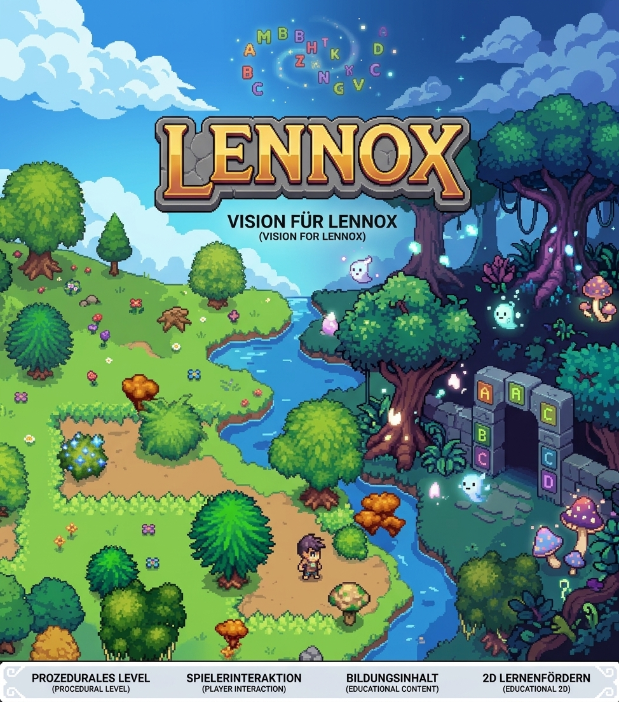
</p>


## 📖 Descripcion

**Lennox** es un juego educativo 2D desarrollado con **Godot Engine 4.x**, disenado para ayudar a los ninos a aprender a leer en **ingles y espanol** de manera interactiva y divertida. El proyecto combina mecanicas de juego atractivas con contenido pedagogico de alta calidad, priorizando siempre la experiencia del usuario y el aprendizaje efectivo.

## 🌟 Vision de Lennox

<p align="center">
  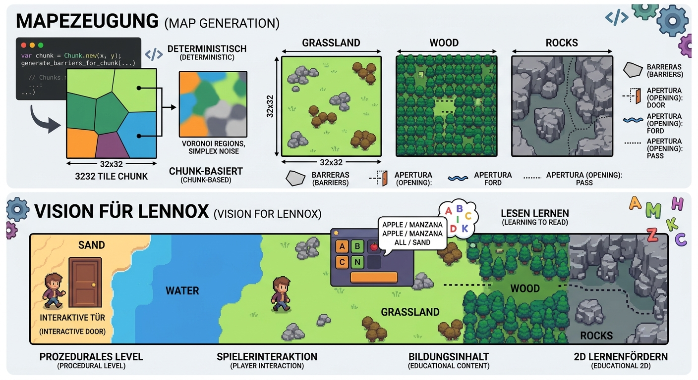
</p>

---

## 🎬 Daily Screencap

<p align="center"><strong>La captura más reciente del juego</strong></p>


https://github.com/user-attachments/assets/e90fa3b8-fab1-437a-a054-e5f138264e31

---

## 🗺️ Generacion procedural del mapa

<p align="center">
  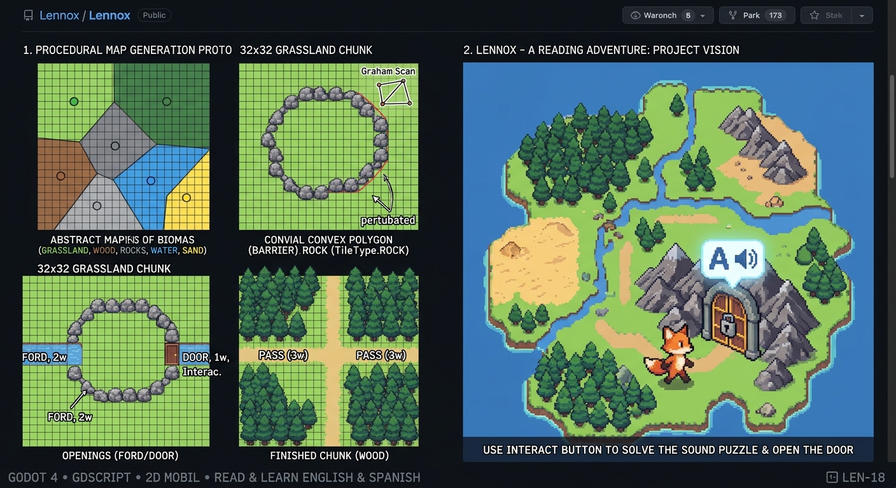
</p>

### 🌍 Vista panoramica del mundo generado por semilla (*Seed*)

Todo el mundo de **Lennox** se genera de forma 100 % procedural y determinista a partir de una única **semilla numérica (*seed*)**:

- **Reproducibilidad exacta**: La misma semilla produce siempre el mismo mapa (regiones de biomas, mesetas continuas entre *chunks*, pasos transitables y distribución ecológica de objetos). Cambiar la semilla crea un mundo completamente nuevo.
- **Transiciones y relieve continuo**: Mediante diagramas de Voronoi con *domain warping* (`FastNoiseLite`) y campos de elevación macro, los **8 biomas** se integran de forma orgánica con acantilados en perspectiva 3/4 y vegetación propia de cada entorno.

<p align="center">
  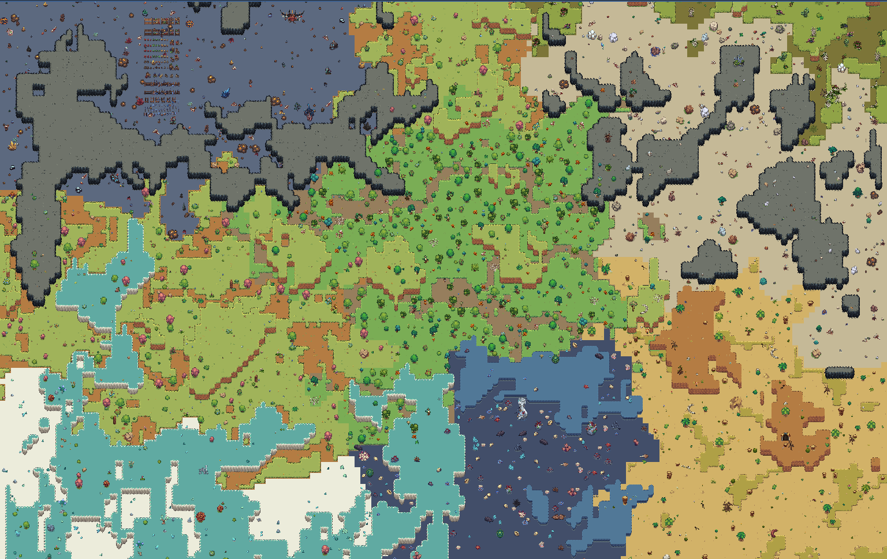
</p>

---

## 🌿 Referencias visuales de los biomas

Estas imágenes muestran los estilos y conjuntos visuales previstos para los distintos entornos. 

!!! All credits go to @craftpix.net and their great top down tileset artwork <3 !!!

<table>
 <tr><th>Cueva</th><th>Desierto</th></tr>
 <tr>
   <td>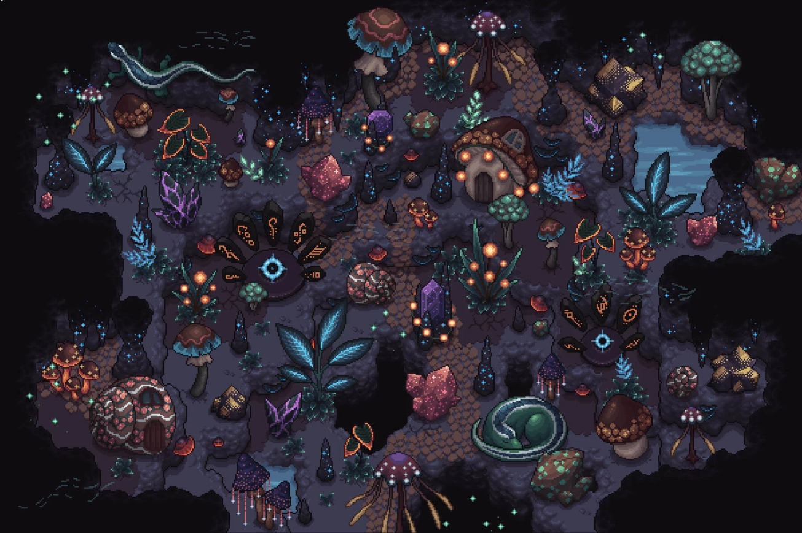</td>
   <td>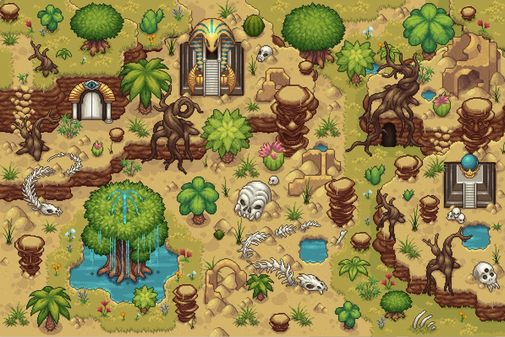</td>
 </tr>
 <tr><th>Bosque</th><th>Pradera</th></tr>
 <tr>
   <td>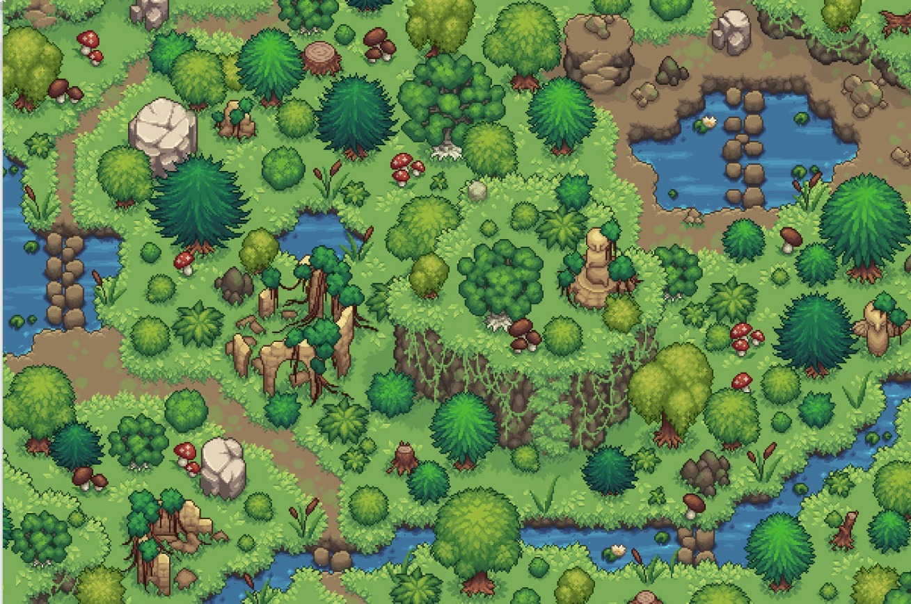</td>
   <td>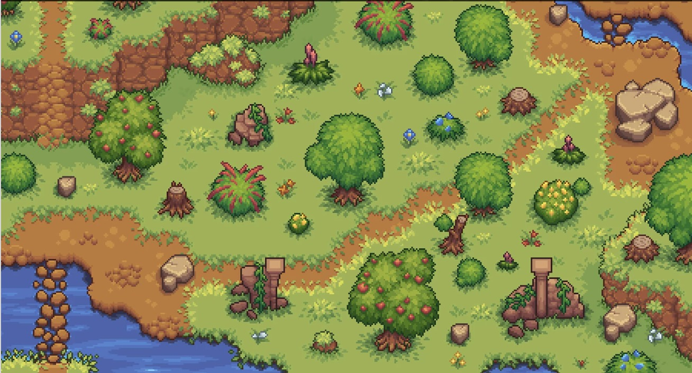</td>
 </tr>
 <tr><th>Rocas</th><th>Rocas y agua</th></tr>
 <tr>
   <td>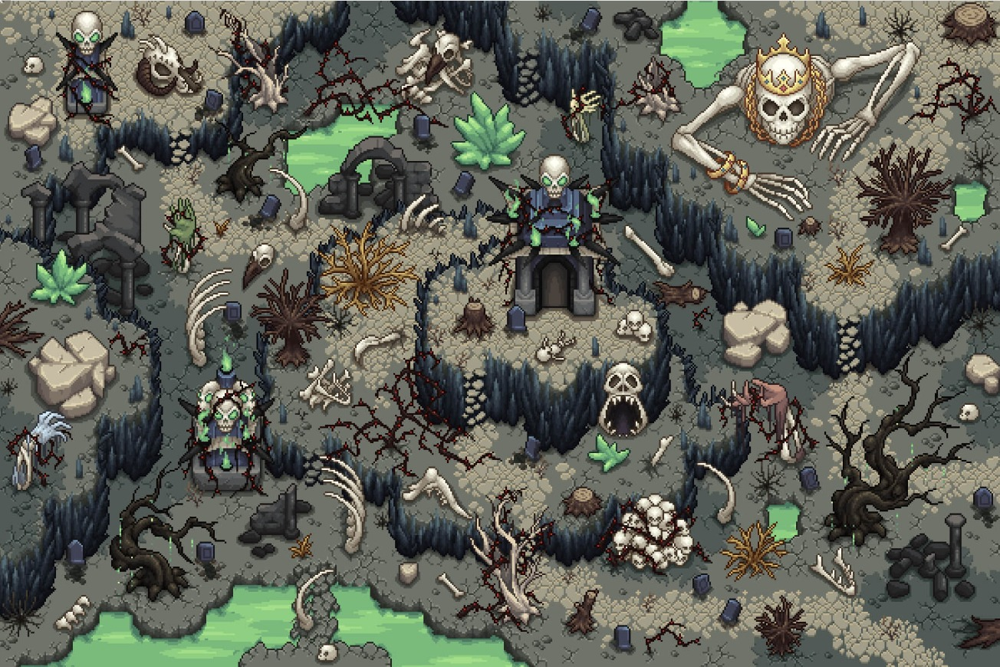</td>
   <td>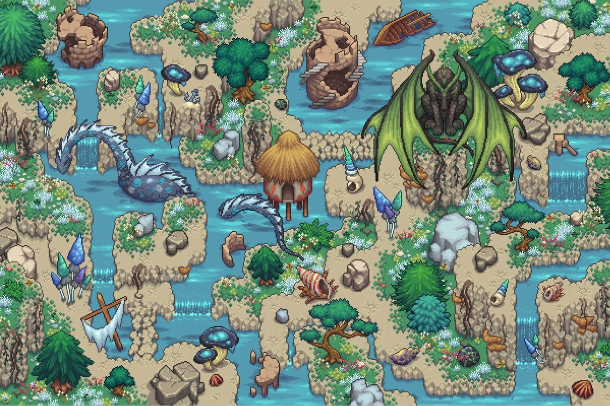</td>
 </tr>
 <tr><th>Pantano</th><th>Agua</th></tr>
 <tr>
   <td>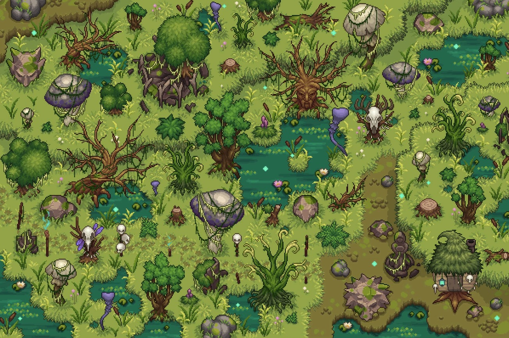</td>
   <td>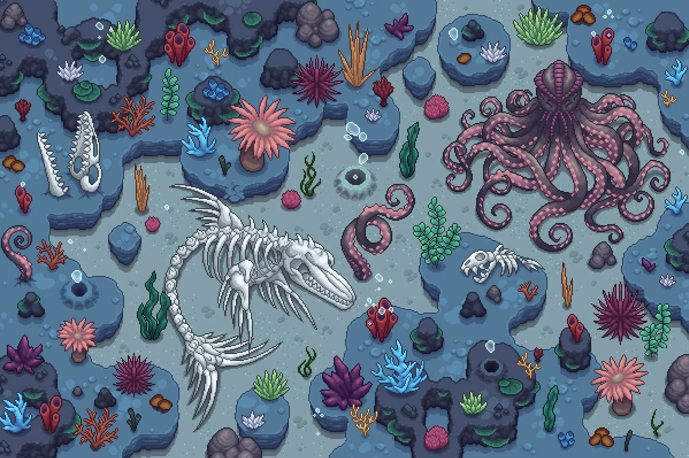</td>
 </tr>
</table>

La animación de la cueva también está disponible en [`assets/cave_overview_animated.mp4`](assets/cave_overview_animated.mp4).

---

## 🎮 Estado del Proyecto y Hoja de Ruta de Jira

El desarrollo de **Lennox** se organiza y supervisa de forma estructurada a traves de **Atlassian Jira**. Los prefijos y numeros (por ejemplo, `LEN-3`, `LEN-5`) corresponden a los tickets y tareas oficiales dentro del proyecto de Jira:

- **Espacio de trabajo de Jira:** [devhoelzlsebastian.atlassian.net](https://devhoelzlsebastian.atlassian.net/jira/software/projects/LEN/boards/35?filter=&groupBy=none)
- **Clave del proyecto:** `LEN` (Lennox)

### 📊 Estado Actual de Tareas e Hitos

| Ticket | Titulo / Hito | Estado | Detalles |
| :--- | :--- | :---: | :--- |
| **LEN-3** | Definir la estructura de niveles y chunks | ✅ Completado | Estructura del nivel y acceso a chunks por coordenadas |
| **LEN-10** | Configurar el entorno de pruebas TDD | ✅ Completado | Godot, VS Code y GUT |
| **LEN-11** | Implementar las clases Level y Chunk con TDD | ✅ Completado | Clases principales de nivel y chunks |
| **LEN-13** | Implementar el sistema de biomas | ✅ Completado | 8 biomas canónicos, mapa determinista con Voronoi y FastNoiseLite domain warping |
| **LEN-14** | Generador de mundo orgánico de cuento de hadas | ✅ Completado | Formaciones naturales armónicas, grandes mesetas y pasos transitables |
| **LEN-15** | Colocar aperturas en las barreras | ✅ Completado | Aperturas generadas e interactivas (puertas, desfiladeros, vados) |
| **LEN-34** | Población ecológica y catálogo de objetos | ✅ Completado | Catálogo dinámico `ObjectCatalog` y 4 reglas de población para los 8 biomas |
| **LEN-17** | Pruebas de integración de barreras y chunks | ✅ Completado | Pruebas unitarias y de integración para la generación y aplicación de formaciones |
| **LEN-16** | Integrar Godot y crear nivel de demostración | ✅ Completado | Escena de exploración con cámara suave, zoom y ordenación en Y |
| **LEN-20** | Añadir características de mundo entre chunks | 📋 Por hacer | Soporte para ríos continuos entre límites de chunks |

---

## 🛠 Tecnologias

- **Motor**: [Godot Engine 4.x](https://godotengine.org/) (GDScript)
- **Testing**: [GUT](https://github.com/bitwes/Gut) (Godot Unit Test)
- **Estructura del proyecto**:
  ```
  lennox/
  ├── src/
  │   └── core/
  │       ├── level.gd                 # Generacion de niveles, mesetas entre chunks y mundo organico
  │       ├── chunk.gd                 # Sistema de chunks, grilla de baldosas y objetos poblados
  │       ├── terrain_painter.gd       # Motor de autotiling: suelos, acantilados 3/4 y derrames
  │       ├── terrain_styles.gd        # Estilos de suelo y acantilado para los 8 biomas (datos)
  │       ├── cliff_autotiler.gd       # Clasificador 9-slice basado en patrones de TileSet
  │       ├── tile_mapper.gd           # Dibujado de TilePattern sobre TileMapLayer
  │       ├── tile_pattern.gd          # Modelo de datos para patrones de baldosas (TilePattern)
  │       ├── tile_pattern_registry.gd # Registro y consulta indexada de patrones
  │       ├── corner_type.gd           # Enum de esquinas de patrones (CornerType)
  │       ├── hull_curvature.gd        # Enum de curvatura de bordes (HullCurvature)
  │       ├── object_catalog.gd        # Catalogo dinamico de activos para los 8 biomas y comunes
  │       ├── biome_config.gd          # Perfiles y parametros de configuracion de biomas
  │       ├── biome_generator.gd       # Generador determinista de biomas (Voronoi + Domain Warping)
  │       ├── barrier.gd               # Poligonos de barreras naturales y consulta de aperturas
  │       ├── opening.gd               # Aperturas generadas e interactivas (puertas, vados, pasos)
  │       ├── biome_type.gd            # Enum global de los 8 biomas (BiomeType)
  │       └── tile_type.gd             # Enum global de tipos de baldosa (TileType)
  ├── test/
  │   ├── unit/                        # Tests unitarios con GUT (10 suites, 77 tests)
  │   │   ├── test_barrier.gd
  │   │   ├── test_biome.gd
  │   │   ├── test_chunk.gd
  │   │   ├── test_cliff_autotiler.gd
  │   │   ├── test_level.gd
  │   │   ├── test_object_catalog.gd
  │   │   ├── test_terrain_painter.gd
  │   │   ├── test_tilemapper.gd
  │   │   ├── test_tilepattern.gd
  │   │   └── test_tilepattern_registry.gd
  │   └── integration/                 # Tests de integracion con GUT (1 suite, 6 tests)
  │       └── test_barrier_chunk_integration.gd
  ├── assets/
  │   ├── biomes/                      # Activos de los 8 biomas (tiles, objects y <bioma>_16x16.tres)
  │   ├── common/                      # Activos compartidos (trees, bushes, ruins, crystals, etc.)
  │   ├── player_sprites/              # Spritesheets animados del personaje (walk, idle, run)
  │   ├── tiles/rocks/                 # TileSet maestro (rocks_16x16.tres) y biblioteca de patrones
  │   └── title_art/                   # Arte conceptual y portada del proyecto
  ├── scenes/
  │   ├── main.tscn                    # Escena principal del mundo generado
  │   ├── main.gd                      # Controlador de escena, camara suave y zoom
  │   ├── level.gd                     # Renderizado multicapa del terreno (TerrainPainter) y objetos
  │   ├── player.gd                    # Controlador del jugador, movimiento y animaciones
  │   ├── terrain_lab.tscn             # Escena del laboratorio visual de estilos por bioma
  │   ├── terrain_lab.gd               # Generador de galeria de pruebas para los 8 biomas
  │   ├── test_autotiling_level.tscn   # Escena de prueba de autotiling para los 8 biomas
  │   ├── test_autotiling_level.gd     # Script de escena de prueba de autotiling
  │   └── grassland_test_pattern.tscn  # Escena de referencia manual de patrones en pradera
  ├── doc/
  │   ├── map-generation.md            # Arquitectura del generador de mundo y autotiling 3/4
  │   ├── biomes.md                    # Catalogo y guia visual de los 8 biomas
  │   ├── barriers.md                  # Formaciones naturales, mesetas y aperturas
  │   ├── level-structure.md           # Estructura de niveles y coordenadas de chunks
  │   ├── snap-in-mechanism.md         # Mecanismo de encaje de piezas y patrones
  │   ├── images/                      # Capturas de pantalla y diagramas de arquitectura
  │   └── video/                       # Videos de demostracion (daily_screencap.mp4)
  └── README.md
  ```

---

## 🚀 Instalacion y Ejecucion

### Requisitos
- [Godot Engine 4.x](https://godotengine.org/download) (recomendado: 4.2+)

### Pasos
1. Clona el repositorio:
   ```bash
   git clone https://github.com/SebastianHoelzlSoftware/Lennox.git
   cd Lennox
   ```
2. Abre el proyecto en Godot:
   - Ejecuta `project.godot` con Godot Engine
   - O arrastra la carpeta del proyecto al editor

3. **Iniciar el juego**:
   - En el panel **FileSystem**, selecciona y abre `scenes/main.tscn`.
   - Pulsa **F6** (**Run Current Scene**) para ejecutar la escena principal.
   - No uses **F5** para iniciar el juego: el proyecto tiene GUT configurado como escena de inicio.

4. **Ejecutar pruebas** (opcional):
   - Abre el panel **GUT** en el editor de Godot
   - Ejecuta los tests utilizando la interfaz grafica de GUT

---

## 🧪 Pruebas

El proyecto incluye pruebas unitarias y de integracion con **GUT** (Godot Unit Test). La suite actual contiene 77 pruebas unitarias y 6 de integracion (83 en total), con una tasa de exito del 100%.

| Suite | Cantidad | Cobertura |
|-------|---------:|-----------|
| [`test_barrier.gd`](test/unit/test_barrier.gd) | 15 | Poligonos, consultas de puntos, aperturas pasables y estados de puertas |
| [`test_biome.gd`](test/unit/test_biome.gd) | 11 | Generacion de biomas, determinismo, parametros y perfiles |
| [`test_chunk.gd`](test/unit/test_chunk.gd) | 11 | Inicializacion de chunks, barreras y aplicacion de baldosas |
| [`test_cliff_autotiler.gd`](test/unit/test_cliff_autotiler.gd) | 7 | Clasificacion 9-slice, esquinas, bordes y dibujado de mesetas |
| [`test_level.gd`](test/unit/test_level.gd) | 15 | Generacion de niveles, reglas de forma, estilos y poblacion de objetos |
| [`test_object_catalog.gd`](test/unit/test_object_catalog.gd) | 5 | Catalogo de activos para los 8 biomas y categorias comunes |
| [`test_terrain_painter.gd`](test/unit/test_terrain_painter.gd) | 6 | Autotiling 3x3 + esquinas concavas, caras 3/4, derrames y estilos |
| [`test_tilemapper.gd`](test/unit/test_tilemapper.gd) | 3 | Dibujado de patrones en TileMapLayer |
| [`test_tilepattern.gd`](test/unit/test_tilepattern.gd) | 1 | Creacion y validacion de patrones de baldosas |
| [`test_tilepattern_registry.gd`](test/unit/test_tilepattern_registry.gd) | 3 | Registro e integridad de indices de patrones |
| [`test_barrier_chunk_integration.gd`](test/integration/test_barrier_chunk_integration.gd) | 6 | Integracion de barreras y aperturas generadas con chunks y baldosas |


### Ejecutar pruebas:
Desde la raíz del proyecto, también se puede ejecutar toda la suite en modo *headless* si Godot está disponible en `PATH`:

```sh
godot --headless --path . -s addons/gut/gut_cmdln.gd -gdir=res://test -ginclude_subdirs -gprefix=test_ -gexit
```

O busca el panel **GUT** en el editor y ejecuta los tests con la interfaz gráfica:


<p align="center">
  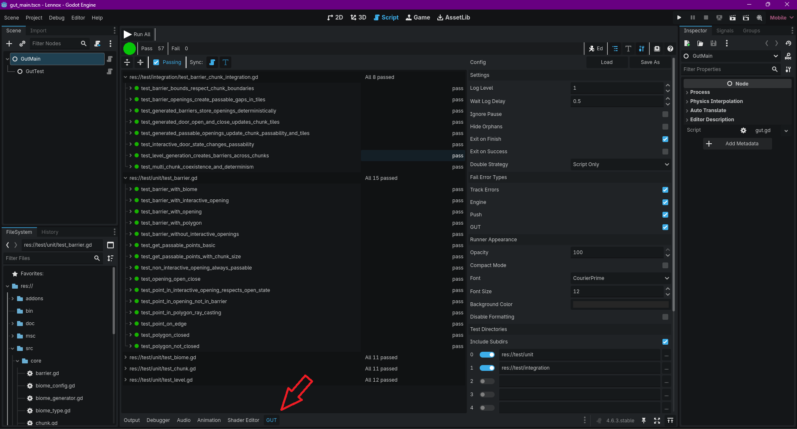
</p>

---

## 🤝 Contribucion

¡Las contribuciones son bienvenidas! Si deseas colaborar:

1. Haz un *fork* del repositorio
2. Crea una rama con tu caracteristica (*feature*):
   ```bash
   git checkout -b feature/nueva-funcionalidad
   ```
3. Realiza tus cambios y anade pruebas si es relevante
4. Envia un *Pull Request* con una descripcion clara

**Normas:**
- Usa **GDScript** con tipado estatico (`: int`, `: String`, etc.)
- Sigue el estilo de codigo existente (nombres descriptivos, comentarios en docstrings)
- Asegurate de que todos los tests pasen antes de enviar un PR

---

## 📜 Licencia

Este proyecto esta bajo la licencia **MIT**. Consulta el archivo [LICENSE](LICENSE) para mas detalles.

---

## 📧 Contacto

Para preguntas o sugerencias:
- **Autor**: Sebastian Hoelzl
- **Repositorio**: [SebastianHoelzlSoftware/Lennox](https://github.com/SebastianHoelzlSoftware/Lennox)

---

> *"La educacion es el arma mas poderosa para cambiar el mundo."* — Nelson Mandela
